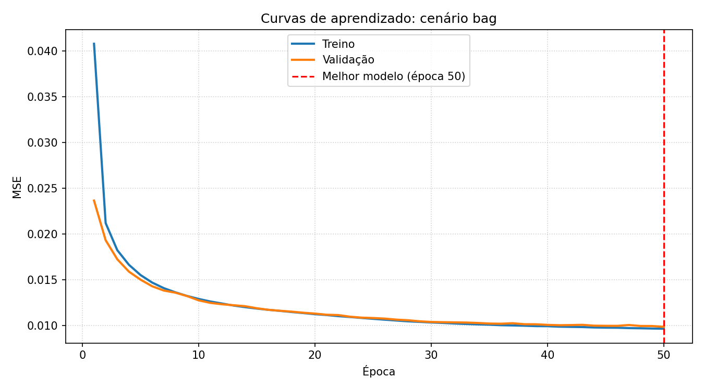
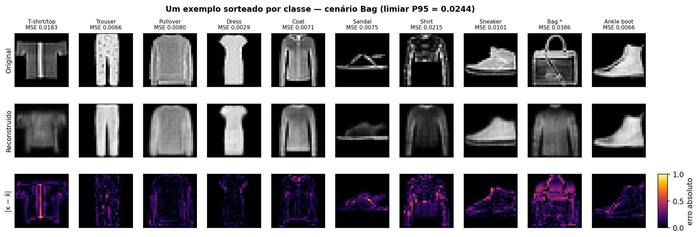
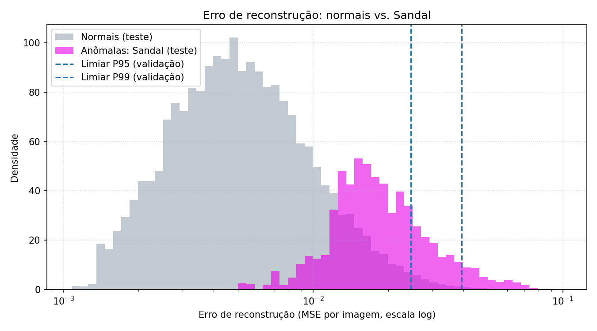
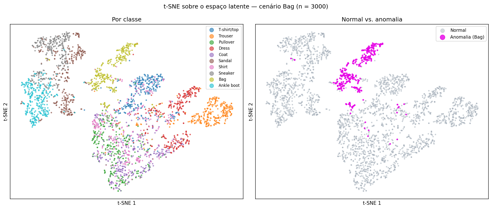
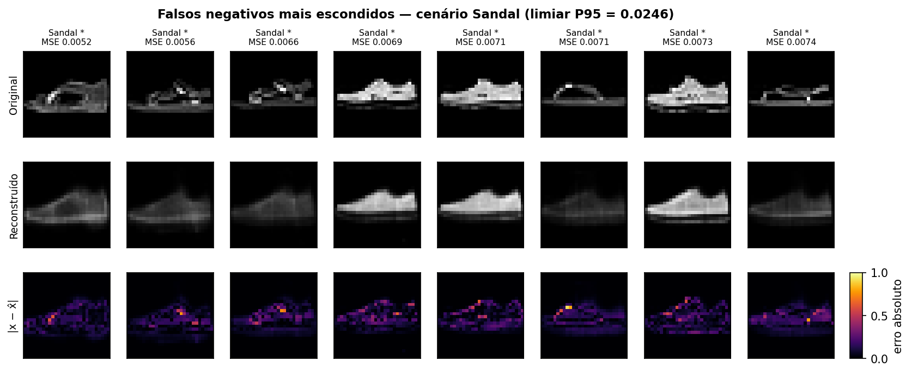
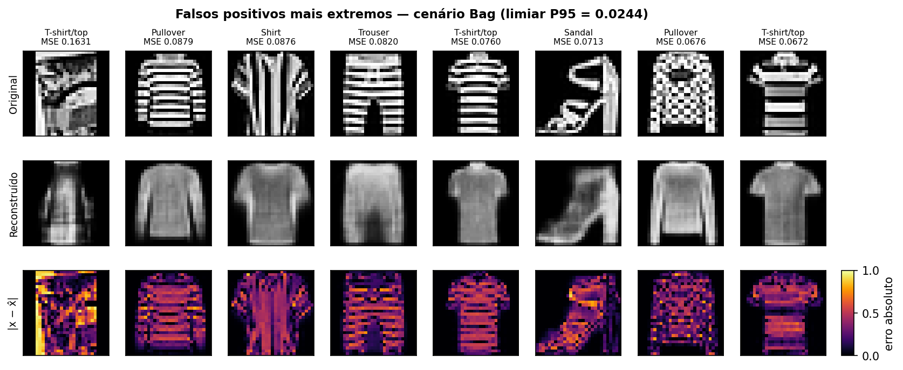

# Relatório — Projeto Final 1: Autoencoder

> Compressão, reconstrução e detecção de anomalias no Fashion-MNIST.
>
> **Regra do documento:** todo número citado aqui vem de um arquivo em `reports/`,
> gerado por um experimento que de fato rodou. Nada estimado ou arredondado à mão
> além do número de casas decimais.
>
> **Status:** completo. A seção 5.5 (modelo convolucional) não foi realizada; ver limitações.

Para instalar e executar o projeto, veja o [README](../README.md).

---

## 1. O problema

Detectar anomalias é encontrar exemplos que fogem do padrão: uma peça com defeito numa linha de produção, uma transação fraudulenta, um exame fora do normal. Na prática, esse problema costuma ter uma característica em comum: **há muitos exemplos normais e pouquíssimos (ou nenhum) exemplos de anomalia**. Além disso, as anomalias futuras podem ser de tipos que nunca foram vistos.

Por isso, em vez de treinar um classificador com exemplos dos dois tipos, este projeto segue a abordagem de **aprendizado não supervisionado**: o modelo aprende apenas como os dados normais se parecem e marca como anomalia aquilo que ele não consegue reproduzir bem.

O projeto atende aos requisitos da disciplina:

| Requisito | Onde está |
|---|---|
| Escolher uma base de dados | Seção 2 |
| Treinar um Autoencoder para reconstruir os dados | Seções 4.4 e 4.5 |
| Analisar o espaço latente | Seção 5.3 |
| Analisar o erro de reconstrução | Seções 5.1 e 5.2 |
| Usar o erro para detectar anomalias | Seções 4.6 e 5.2 |
| Visualizações antes/depois da reconstrução | Seção 5.1 |
| Exemplos de falhas | Seção 5.4 |
| Análise crítica | Seções 6 e 7 |
| Demonstração interativa (extra) | `app/app.py` (README, seção "Demonstração interativa") |

## 2. Por que o Fashion-MNIST

O [Fashion-MNIST](https://github.com/zalandoresearch/fashion-mnist) tem 70 mil imagens de 28×28 pixels em tons de cinza, divididas em 10 classes de roupas e acessórios (60 mil para treino e 10 mil para teste, com 1.000 imagens por classe no teste).

Ele foi escolhido por três motivos:

1. **Visualização intuitiva:** qualquer pessoa vê se a reconstrução de uma camiseta ficou boa ou borrada, o que torna os resultados explicáveis na apresentação.
2. **Rótulos disponíveis:** o Autoencoder é treinado sem rótulos, mas os rótulos permitem *medir* a detecção (ROC-AUC, precisão, recall) e colorir o espaço latente por classe.
3. **Viável em CPU:** cada treino leva poucos minutos, então todos os membros conseguem reproduzir os experimentos.

**Limitação assumida desde o início:** o Fashion-MNIST não tem "defeitos". Simulamos anomalias tratando **uma classe inteira como anômala** e deixando-a fora do treino. Isso mede a capacidade de reconhecer *um tipo de objeto nunca visto*, que é mais fácil do que reconhecer um defeito sutil em um objeto conhecido. As conclusões devem ser lidas com essa ressalva (seção 7).

## 3. Como funciona um Autoencoder

```
imagem (784) → ENCODER → espaço latente (16) → DECODER → reconstrução (784)
```

**Encoder, espaço latente e decoder.** O Autoencoder tem duas metades. O **encoder** recebe a imagem, com 784 números (um para cada pixel), e vai comprimindo essa informação até sobrarem só 16 números. Esses 16 números são o **espaço latente**: um "resumo" da imagem, com o que ela tem de mais importante. O **decoder** faz o caminho inverso: pega esse resumo e tenta reconstruir a imagem original, de volta com 784 números.

**Por que o modelo não aprende simplesmente a copiar a entrada.** Porque ele não tem espaço para isso. No meio do caminho, a imagem precisa caber em 16 números, ou seja, 49 vezes menos informação do que os 784 pixels. Não dá para guardar cada detalhe, então o modelo é obrigado a aprender o que é essencial, como a forma geral de uma camiseta ou de um tênis, e descartar o resto. Esse "gargalo" é o que força o modelo a aprender padrões, em vez de decorar.

**O erro de reconstrução como medidor de anomalia.** O erro de reconstrução mede o quanto a imagem devolvida pelo modelo ficou diferente da original. Se o modelo conhece bem aquele tipo de imagem, ele reconstrói bem, e o erro é pequeno. Se a imagem é de um tipo que ele não conhece, a reconstrução sai ruim, e o erro é grande. Basta então definir um limite: acima dele, a imagem é considerada uma anomalia (seção 4.6).

**Por que treinar só com dados normais funciona.** Durante o treino, o modelo só aprendeu a resumir e reconstruir roupas e calçados. Ele nunca viu uma bolsa, então não sabe como "resumir" uma. Quando recebe uma bolsa, ele tenta encaixá-la no que conhece e devolve algo parecido com uma blusa ou outra peça que já viu. A reconstrução fica diferente da bolsa original, e o erro sobe. Nos nossos resultados, a Bag teve o maior erro médio de todas as classes (MSE 0,0312; seção 5.1).

**Quando essa ideia falha.** Quando a anomalia é parecida com algo que o modelo já conhece. As sandálias são o melhor exemplo: o modelo as reconstruiu como se fossem tênis, que ele viu no treino. Além disso, a sandália é um objeto pequeno e cheio de espaços vazios, então a maior parte da imagem é fundo preto, e o fundo o modelo reconstrói perfeitamente. Com isso, o erro médio da imagem inteira fica baixo, mesmo com o objeto errado. Por isso o detector encontrou só 41% das sandálias, contra 71% das bolsas (seções 5.2 e 5.4).

## 4. Metodologia

### 4.1 Dados e divisão dos conjuntos

Fonte: issue #2 (Rafael), `reports/eda_summary.json`.

A estratégia é **one-class**: o modelo só vê a classe normal durante o treino. A classe anômala é removida do treino oficial **antes** da divisão entre treino e validação, e a divisão é estratificada (mesma proporção de cada classe nos dois conjuntos), com seed fixa (42).

Cenário com **Bag** como anomalia:

| Conjunto | Origem | Imagens | Por classe | Anomalias |
|---|---|---:|---:|---:|
| Treino | treino oficial, 85% | 45.900 | 5.100 (9 classes) | 0 |
| Validação | treino oficial, 15% | 8.100 | 900 (9 classes) | 0 |
| Teste | teste oficial | 10.000 | 1.000 (10 classes) | 1.000 |

O cenário com **Sandal** como anomalia tem os mesmos tamanhos, trocando a classe excluída.

**Por que dois cenários?** Para comparar uma anomalia de formato bem diferente das demais classes (Bag) com uma anomalia parecida com classes normais (Sandal, próxima de Sneaker e Ankle boot). Isso mostra quando o método funciona e quando ele tem dificuldade.

### 4.2 Como evitamos vazamento de dados

Vazamento de dados acontece quando uma informação que não estaria disponível no uso real influencia o treino ou as decisões do modelo. O resultado é um desempenho "bonito e falso". O projeto segue três regras:

1. **Treino e validação nunca contêm a classe anômala.** Verificado por teste automatizado (#2) e confirmado nas tabelas por classe da avaliação (#6).
2. **O limiar de anomalia é escolhido somente com os erros da validação.** Há um teste automatizado provando que mudar os dados de teste não muda o limiar (#6).
3. **O conjunto de teste é usado apenas para medir**, depois que todas as decisões foram tomadas.

Durante o projeto, essa regra pegou um problema real: uma versão do script de treino usava uma divisão própria, e a maior parte da validação oficial teria caído no treino desse script. O limiar seria calculado sobre imagens já vistas. O problema foi identificado na revisão e corrigido antes do merge (PR #16).

### 4.3 Análise exploratória e hipóteses (registradas antes do treino)

Fonte: issue #3 (Rafael), `notebooks/01_eda.ipynb`, `reports/validacao_dados_eda.md`.

As hipóteses abaixo foram registradas em 08/11/2026 (PR #12), **antes de qualquer modelo ser treinado**. Isso importa: hipóteses escritas depois dos resultados tendem a ser ajustadas para combinar com eles.

| Hipótese | Enunciado |
|---|---|
| H1 | A Bag tende a ter maior erro e mais separação, sem garantia de ser o cenário mais fácil. |
| H2 | A Sandal pode gerar falsos negativos, por semelhança com outros calçados e pela grande área de fundo. |
| H3 | Exemplos incomuns de classes normais podem gerar falsos positivos. |

**Linha de base nos pixels brutos** (PR #13, Luiz): antes do modelo, projetamos os próprios pixels com PCA e t-SNE (`reports/figures/pixels_*_anomaly8.png`). Isso permite comparar depois se o espaço latente organiza os dados melhor do que os pixels sozinhos (seção 5.3).

### 4.4 Arquitetura do Autoencoder

Fonte: issue #4 (Eduardo), `src/autoencoder/model.py`.

```
Entrada 28×28 → 784
Encoder:  784 → 256 → 64 → 16     (ReLU nas camadas ocultas; gargalo linear)
Decoder:   16 → 64 → 256 → 784    (ReLU nas camadas ocultas; Sigmoid na saída)
Saída 784 → 28×28
```

- **Dimensão latente:** 16, ou seja, cada imagem é comprimida de 784 para 16 números.
- **Parâmetros:** 437.664.
- **Saída com Sigmoid:** limita os pixels reconstruídos ao intervalo [0, 1], o mesmo dos pixels de entrada.
- **Gargalo linear:** a primeira versão tinha ReLU no gargalo. Na revisão do PR #15, o treino mostrou que parte das 16 dimensões "morria" (sempre zero) e a reconstrução piorava. O ReLU foi removido.
- **Função de perda:** MSE (erro quadrático médio por pixel), uma comparação direta de intensidade.
- O modelo aceita tanto `(B, 784)` quanto `(B, 1, 28, 28)` e devolve a reconstrução no mesmo formato, para que um modelo convolucional (#9) possa ser trocado sem mudar o resto do código.

### 4.5 Treinamento

Fonte: issues #5 (William) e #6 (Letícia), `reports/history_bag.json`, `reports/history_sandal.json`.

| Hiperparâmetro | Valor |
|---|---|
| Otimizador | Adam |
| Learning rate | 0,001 |
| Batch size | 128 |
| Máximo de épocas | 50 |
| Early stopping | paciência de 5 épocas, melhora mínima de 0,00001 na perda de validação |
| Hardware | não registrado nos checkpoints oficiais (o `scripts/train.py` da #5 passou a registrar) |

| Cenário | Épocas treinadas | Melhor época | Perda de validação (MSE) | Perda de treino final |
|---|---:|---:|---:|---:|
| Bag | 50 | 50 | 0,009858 | 0,009651 |
| Sandal | 50 | 49 | 0,010036 | 0,009755 |



- **Não houve overfitting:** as curvas de treino e validação ficam praticamente juntas até o fim.
- **O early stopping não foi acionado:** os dois treinos atingiram o limite de 50 épocas e o modelo ainda estava melhorando, levemente. Mais épocas poderiam reduzir um pouco a perda (seção 7).
- **Reprodutibilidade:** na mesma máquina, o treino com a seed 42 é determinístico. Entre máquinas com número diferente de threads de CPU, os números variam levemente; por isso, todos os resultados deste relatório vêm dos **mesmos checkpoints** (`ae_bag.pt` e `ae_sandal.pt`).

### 4.6 Limiar e métricas

Fonte: issue #6 (Letícia), `src/autoencoder/evaluate.py`, `reports/avaliacao_deteccao.md`.

**Regra de decisão:** uma imagem é marcada como anomalia quando o seu erro de reconstrução (MSE) é maior que um limiar. O limiar é um **percentil dos erros da validação**, que só tem imagens normais:

- **P95:** cerca de 5% das imagens normais ficam acima do limiar (são marcadas por engano). Mais sensível.
- **P99:** cerca de 1% das normais ficam acima. Mais conservador.

**Métricas usadas:**

| Métrica | O que mede | Depende do limiar? |
|---|---|---|
| MSE / MAE / RMSE | Qualidade da reconstrução | Não |
| ROC-AUC | Probabilidade de uma anomalia ter erro maior que uma imagem normal | Não |
| PR-AUC | Precisão média ao longo dos possíveis limiares; mais exigente quando as anomalias são raras (10% do teste) | Não |
| Precisão | Das imagens marcadas como anomalia, quantas eram mesmo | Sim |
| Recall | Das anomalias reais, quantas foram encontradas | Sim |
| F1 | Equilíbrio entre precisão e recall | Sim |

O grupo adotou o **P95** como limiar principal, porque neste problema deixar passar uma anomalia é mais grave do que revisar alguns alarmes falsos. Essa escolha foi feita depois de ver os resultados do teste, por isso os dois limiares são reportados completos (seção 5.2).

## 5. Resultados

### 5.1 Reconstrução

Fonte: `reports/resultados_por_classe.csv`, `reports/figures/recon_*.png`.

Erro de reconstrução médio (MSE) no teste, por classe:

| Classe | Cenário Bag | Cenário Sandal |
|---|---:|---:|
| **Bag** | **0,0312** (anômala) | 0,0176 |
| **Sandal** | 0,0167 | **0,0260** (anômala) |
| Ankle boot | 0,0108 | 0,0108 |
| Shirt | 0,0108 | 0,0107 |
| T-shirt/top | 0,0101 | 0,0099 |
| Dress | 0,0099 | 0,0099 |
| Pullover | 0,0097 | 0,0098 |
| Coat | 0,0092 | 0,0092 |
| Sneaker | 0,0080 | 0,0082 |
| Trouser | 0,0052 | 0,0050 |

Nos dois cenários, a classe anômala tem o **maior erro médio de todas**. A segunda maior é sempre a outra classe "difícil".



Composição das 100 melhores e 100 piores reconstruções do teste (saída de `notebooks/04_reconstructions.ipynb`):

| | Cenário Bag | Cenário Sandal |
|---|---|---|
| 100 melhores | Trouser 81, T-shirt/top 10, outras 9 | Trouser 93, outras 7 |
| 100 piores | **Bag 60**, Sandal 12, outras 28 | **Sandal 71**, outras 29 |

- **Melhores:** calças, de silhueta simples (`recon_melhores_*.png`).
- **Piores:** dominadas pela classe anômala (`recon_piores_*.png`).

### 5.2 Detecção de anomalias

Fonte: `reports/resultados_deteccao.csv`.

| Cenário | Limiar | ROC-AUC | PR-AUC | Precisão | Recall | F1 | Falsos positivos | Falsos negativos |
|---|---|---:|---:|---:|---:|---:|---:|---:|
| Bag | P95 | 0,9516 | 0,5972 | 0,599 | 0,710 | 0,650 | 475 | 290 |
| Bag | P99 | 0,9516 | 0,5972 | 0,682 | 0,210 | 0,321 | 98 | 790 |
| Sandal | P95 | 0,8955 | 0,4523 | 0,467 | 0,406 | 0,435 | 463 | 594 |
| Sandal | P99 | 0,8955 | 0,4523 | 0,635 | 0,155 | 0,249 | 89 | 845 |



- **A Bag é mais fácil de detectar que a Sandal** em todas as métricas.
- **ROC-AUC alto não significa detector pronto:** com P95, no cenário Bag, 4 em cada 10 imagens marcadas são alarmes falsos (precisão 0,599).
- **Trocar P95 por P99** reduz os falsos positivos em ~80%, mas o recall cai para cerca de um terço.

### 5.3 Espaço latente

Fonte: issue #7 (Luiz), `reports/latent_space_summary.json`, `reports/figures/latent_*.png`.

Para medir a organização sem a distorção das figuras 2D, calculamos, para cada imagem, **que fração dos 10 vizinhos mais próximos é da mesma classe**, nas 16 dimensões do espaço latente e nos 784 pixels.

| Medida | Cenário Bag | Cenário Sandal |
|---|---:|---:|
| Pureza média dos vizinhos, espaço latente (16 dim.) | 0,767 | 0,754 |
| Pureza média dos vizinhos, pixels (784 dim.) | 0,757 | 0,757 |
| Variância explicada pelos 2 primeiros componentes do PCA | 65% | 58% |



- **As classes se organizam em grupos sem que o modelo tenha visto rótulos.** Trouser, Ankle boot, Bag e Sneaker têm mais de 83% de vizinhos da mesma classe; as peças de parte superior se misturam (Shirt ≈ 48%).
- **Comprimir 784 → 16 manteve a organização dos pixels, mas não a melhorou** (pureza média praticamente igual).
- **Bag (anomalia):** forma um grupo próprio, com 92% de vizinhos Bag, mesmo sem nunca ter sido vista no treino.
- **Sandal (anomalia):** 81% de vizinhos Sandal, mas dentro da região dos calçados (10% Sneaker, 8% Ankle boot).
- No PCA, a Bag parece misturada com blusas. Isso é efeito da projeção: 2 componentes guardam só 65% da variância.

### 5.4 Exemplos de falhas

Fonte: issue #8 (Luiz), `reports/reconstructions_summary.json`, `reports/figures/falsos_*.png`. Limiar P95.

**Falsos negativos da Sandal** (594 sandálias não detectadas):



- 81% delas têm Sneaker como classe normal mais próxima no espaço latente: o modelo as reconstrói **como um tênis**.
- O erro no objeto é alto, mas o fundo preto ocupa a maior parte da imagem e dilui o MSE. Medindo o erro **só nos pixels do objeto**, 96% desses falsos negativos ficariam acima do limiar.
- Confirma a **H2**.

**Falsos negativos da Bag** (290 bolsas não detectadas): bolsas retangulares e lisas são reconstruídas como blusas; 27% têm Shirt como classe normal mais próxima no latente.

**Falsos positivos** (imagens normais marcadas como anomalia):



- São principalmente roupas com listras, xadrez e estampas: o gargalo de 16 números devolve uma peça "média" e lisa. Confirma a **H3**.
- A maior fonte de falsos positivos em cada cenário é a outra classe difícil: 16,6% das sandálias no cenário Bag e 16,6% das bolsas no cenário Sandal.

A medida "erro só no objeto" é um **diagnóstico**, não uma nova regra de detecção: ela foi calculada olhando o teste, então usá-la para ajustar o detector seria vazamento.

### 5.5 Denso vs. convolucional

Não realizado (issue opcional #9). Ver seção 7.

## 6. Análise crítica

**As hipóteses se confirmaram.** As três hipóteses registradas antes do treino (seção 4.3) se confirmaram. A Bag teve o maior erro de todas as classes e foi o cenário mais fácil (H1). As sandálias escaparam do detector por parecerem tênis e por terem muito fundo preto (H2). E as roupas com listras e estampas viraram falsos positivos (H3). O fato de as hipóteses terem sido escritas antes dos resultados é o que dá peso a essa confirmação.

**Quando o Autoencoder funcionou e quando falhou.** Ele funciona bem quando a anomalia tem um formato diferente de tudo o que ele viu no treino: no cenário Bag, o ROC-AUC foi 0,95 e o detector encontrou 71% das bolsas. Ele falha quando a anomalia se parece com algo conhecido: no cenário Sandal, o ROC-AUC caiu para 0,90 e o detector encontrou só 41% das sandálias. Ou seja, o Autoencoder não detecta "o que é diferente" em geral; ele detecta "o que ele não consegue imitar". Uma anomalia parecida com uma classe normal é imitada bem o suficiente para passar.

**Separar não é o mesmo que detectar.** Um resultado que chamou atenção: no espaço latente, as sandálias formam um grupo próprio (81% dos vizinhos são sandálias), e mesmo assim o detector deixou passar a maioria delas. Isso acontece porque o detector não usa o espaço latente; ele usa o erro de reconstrução. E o erro é a média de todos os pixels: numa sandália, a maior parte da imagem é fundo preto, que o modelo reconstrói perfeitamente, então o erro no objeto fica "diluído". Medindo o erro só nos pixels do objeto, 96% dessas sandálias teriam sido detectadas. Essa medida foi calculada olhando o teste, então não pode ser usada como regra neste trabalho, mas indica um caminho: o problema não está só no modelo, está também em *como* o erro é medido.

**O espaço latente não organizou melhor que os pixels.** A organização das classes no espaço latente foi praticamente igual à dos pixels brutos (pureza média de 0,767 contra 0,757). Isso não é um fracasso: o modelo conseguiu guardar a mesma estrutura usando 16 números em vez de 784, uma compressão de 49 vezes. Mas mostra que o Autoencoder não "entendeu" as classes melhor do que os próprios pixels; ele aprendeu a resumi-las.

**O limiar é uma troca, não uma resposta certa.** Mesmo com ROC-AUC de 0,95, o detector com limiar P95 marca 475 imagens normais como anomalia no cenário Bag: 4 em cada 10 alertas são falsos. Com P99, os alarmes falsos caem cerca de 80%, mas o detector passa a encontrar só 21% das bolsas. Não existe limiar que resolva os dois problemas ao mesmo tempo; a escolha depende do que custa mais caro no problema real: deixar passar uma anomalia ou revisar um alarme falso.

**Até onde os resultados valem.** Aqui, cada anomalia é uma classe inteira que o modelo nunca viu, o que é mais fácil do que o caso real mais comum, que é um defeito pequeno num objeto conhecido (um risco numa peça, uma costura torta). Pelo que vimos com as sandálias, um defeito pequeno provavelmente teria o mesmo problema de "diluição" do erro, e seria ainda mais difícil de detectar. Então os resultados mostram que a técnica funciona, mas não devem ser lidos como o desempenho esperado num problema real.

**O que faríamos com mais tempo.**
- Treinar por mais épocas, já que os modelos ainda melhoravam quando o treino parou (seção 4.5).
- Repetir os treinos com várias seeds, para medir a variação dos resultados.
- Testar um Autoencoder convolucional, que considera a vizinhança entre os pixels e tende a reconstruir melhor detalhes como listras (issue #9).
- Testar outras dimensões do espaço latente (8 e 32).
- Testar medidas de erro que deem mais peso ao objeto do que ao fundo, escolhendo a regra só com a validação.

## 7. Limitações

1. **Anomalia artificial:** cada anomalia é uma classe inteira nunca vista, não um defeito sutil. O desempenho em defeitos reais tende a ser pior.
2. **Uma única seed e um checkpoint por cenário:** não medimos a variação entre treinos. Os números podem mudar levemente com outra seed ou outra máquina.
3. **Treino limitado a 50 épocas:** o early stopping não foi acionado; os modelos ainda melhoravam.
4. **Um único modelo:** Autoencoder denso, dimensão latente 16. Não testamos outros valores de `latent_dim` nem uma arquitetura convolucional (#9, opcional).
5. **O MSE na imagem inteira dilui erros em objetos pequenos**, como mostram os falsos negativos da Sandal.
6. **Escolha do percentil (P95) feita após ver o teste**, por isso os dois limiares são reportados.
7. **Só dois cenários de anomalia** (Bag e Sandal), das 10 classes possíveis.
8. **Hardware dos checkpoints oficiais não registrado**, o que dificulta reproduzir os números exatos em outra máquina.
