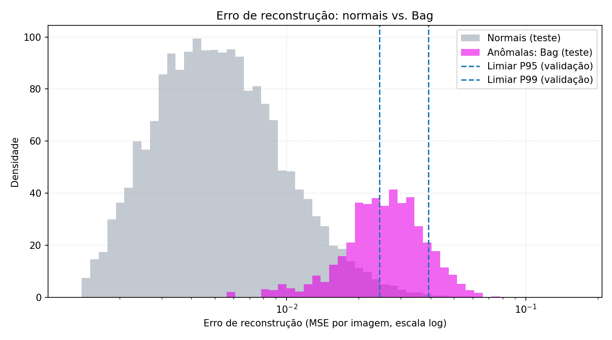
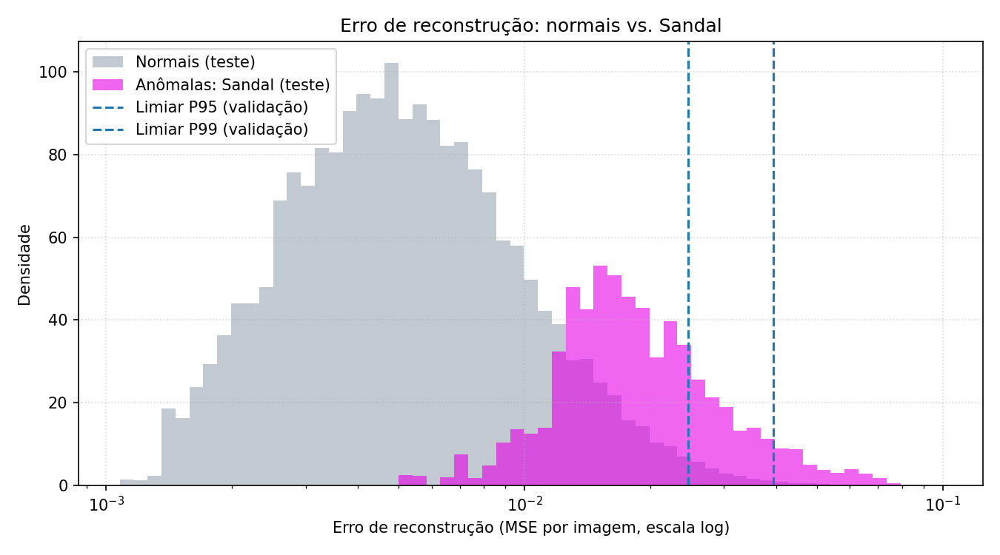

# Avaliação do detector de anomalias (Autoencoder denso, Fashion-MNIST)

> Todos os números abaixo vêm de `python scripts/evaluate.py`
> (`reports/resultados_deteccao.csv` e `reports/resultados_por_classe.csv`).
> Se o script for executado de novo, confira se os números continuam iguais antes de usar este texto.

## 1. Como o detector funciona

1. O Autoencoder é treinado **só com imagens normais** (45.900 no treino).
2. Para cada imagem calculamos o **erro de reconstrução** (MSE por imagem). Quanto maior o erro, mais "estranha" é a imagem.
3. O **limiar** é um percentil do erro na **validação** (8.100 imagens, todas normais). O teste nunca participa dessa escolha.
4. No teste (10.000 imagens, sendo 1.000 anômalas), imagem com erro acima do limiar é marcada como anomalia.

Dois cenários, cada um com um modelo treinado sem a classe anômala:

| Cenário | Classe anômala | Dificuldade esperada |
|---|---|---|
| Bag | Bag | Fácil |
| Sandal | Sandal | Difícil |

Os dois treinos usaram a mesma configuração (50 épocas no máximo). Nenhum dos dois acionou o early stopping: os dois foram até a época 50 (melhor época: 50 no Bag e 49 no Sandal).

## 2. Resultados no teste

Métricas que **não dependem do limiar** (mesmo valor para P95 e P99):

| Cenário | ROC-AUC | PR-AUC |
|---|---|---|
| Bag | 0,9516 | 0,5972 |
| Sandal | 0,8955 | 0,4523 |

Métricas que **dependem do limiar** (limiar calculado só com a validação):

| Cenário | Percentil | Limiar | Precision | Recall | F1 | TN | FP | FN | TP |
|---|---|---|---|---|---|---|---|---|---|
| Bag | 95 | 0,0244 | 0,5992 | 0,7100 | 0,6499 | 8525 | 475 | 290 | 710 |
| Bag | 99 | 0,0391 | 0,6818 | 0,2100 | 0,3211 | 8902 | 98 | 790 | 210 |
| Sandal | 95 | 0,0246 | 0,4672 | 0,4060 | 0,4345 | 8537 | 463 | 594 | 406 |
| Sandal | 99 | 0,0393 | 0,6352 | 0,1550 | 0,2492 | 8911 | 89 | 845 | 155 |

## 3. Erro de reconstrução por classe (teste)

MSE médio da classe anômala comparado com a normal de maior erro:

| Cenário | MSE da classe anômala | Normal com maior MSE |
|---|---|---|
| Bag | 0,0312 (Bag) | 0,0167 (Sandal) |
| Sandal | 0,0260 (Sandal) | 0,0176 (Bag) |

Em ambos os cenários a classe anômala tem o maior erro médio de todas as classes, então o erro de reconstrução funciona como sinal de anomalia. Tabelas completas no **conjunto de teste** (valores arredondados para 4 casas; os valores exatos, incluindo a validação, estão em `reports/resultados_por_classe.csv`). O RMSE é a raiz do MSE médio do grupo. A linha *Global* mistura as 10 classes, inclusive a anômala.

**Cenário Bag** (a classe anômala é Bag):

| Grupo | n | MSE | MAE | RMSE |
|---|---|---|---|---|
| **Global (10 classes)** | 10000 | 0,0122 | 0,0564 | 0,1102 |
| T-shirt/top | 1000 | 0,0101 | 0,0525 | 0,1005 |
| Trouser | 1000 | 0,0052 | 0,0325 | 0,0720 |
| Pullover | 1000 | 0,0097 | 0,0559 | 0,0986 |
| Dress | 1000 | 0,0099 | 0,0481 | 0,0995 |
| Coat | 1000 | 0,0092 | 0,0527 | 0,0957 |
| Sandal | 1000 | 0,0167 | 0,0623 | 0,1291 |
| Shirt | 1000 | 0,0108 | 0,0584 | 0,1039 |
| Sneaker | 1000 | 0,0080 | 0,0398 | 0,0897 |
| Bag (anômala) | 1000 | 0,0312 | 0,1077 | 0,1765 |
| Ankle boot | 1000 | 0,0108 | 0,0541 | 0,1040 |

**Cenário Sandal** (a classe anômala é Sandal):

| Grupo | n | MSE | MAE | RMSE |
|---|---|---|---|---|
| **Global (10 classes)** | 10000 | 0,0117 | 0,0557 | 0,1082 |
| T-shirt/top | 1000 | 0,0099 | 0,0521 | 0,0993 |
| Trouser | 1000 | 0,0050 | 0,0320 | 0,0704 |
| Pullover | 1000 | 0,0098 | 0,0560 | 0,0988 |
| Dress | 1000 | 0,0099 | 0,0479 | 0,0993 |
| Coat | 1000 | 0,0092 | 0,0528 | 0,0960 |
| Sandal (anômala) | 1000 | 0,0260 | 0,0868 | 0,1612 |
| Shirt | 1000 | 0,0107 | 0,0581 | 0,1036 |
| Sneaker | 1000 | 0,0082 | 0,0407 | 0,0908 |
| Bag | 1000 | 0,0176 | 0,0764 | 0,1326 |
| Ankle boot | 1000 | 0,0108 | 0,0539 | 0,1040 |


## 4. Histogramas





Arquivos: `reports/figures/hist_erro_bag.png` e `reports/figures/hist_erro_sandal.png`. As linhas tracejadas são os limiares P95 e P99, calculados só com a validação.
As alturas são densidades (cada grupo tem área igual), porque as anômalas são só 10% do teste.

- **Bag:** as bolsas ficam bem à direita das normais, com uma faixa de sobreposição relativamente pequena.
- **Sandal:** a sobreposição é bem maior. A maior parte das sandálias fica à esquerda dos dois limiares, junto da cauda direita das normais.

## 5. Comparação Bag vs. Sandal

O Bag é mais fácil: ROC-AUC de 0,9516 contra 0,8955 e PR-AUC de 0,5972 contra 0,4523.
Dois fatos dos dados ajudam a explicar a diferença:

- O erro médio da Sandal anômala (0,0260) é menor que o da Bag anômala (0,0312).
- A Bag, quando é normal, já tem erro alto (0,0176), quase no nível da Sandal anômala. Isso mistura as duas distribuições e gera falsos alarmes.

## 6. Escolha do percentil 95 ou 99

Os dois percentis (95 e 99) vieram da definição da issue e foram fixados antes de olhar o teste.

- **P95:** detecta mais anomalias (recall de 0,7100 no Bag e 0,4060 no Sandal), mas gera mais falsos alarmes (475 e 463 normais marcadas como anomalia).
- **P99:** gera poucos falsos alarmes (98 e 89) e a precision sobe, mas deixa passar a maioria das anomalias (recall de 0,2100 e 0,1550).

A escolha depende do custo de cada erro:

- Se **deixar passar uma anomalia é pior** que um falso alarme, o P95 é mais adequado.
- Se **falsos alarmes são caros**, o P99 é mais adequado.

**Decisão do grupo:** escolhemos o **P95**.

Assumimos que, neste problema, deixar passar uma anomalia é pior do que revisar um alerta falso, e que conferir um alerta é uma tarefa barata. Com essa suposição, o P95 é mais útil: detecta uma parte bem maior das anomalias (recall de 0,7100 no Bag e 0,4060 no Sandal, contra 0,2100 e 0,1550 no P99).

O custo dessa escolha são mais falsos alarmes (475 no Bag e 463 no Sandal, contra 98 e 89 no P99) e uma precision menor (0,5992 no Bag e 0,4672 no Sandal). No Bag, cerca de 4 em cada 10 alertas são falsos. No Sandal, quase metade dos alertas é falsa, e mesmo no P95 o detector deixa passar mais da metade das sandálias.

Se o uso real tiver alertas caros de revisar, o P99 seria mais adequado, porque quase não gera falsos alarmes.

Observação: os dois percentis foram definidos de antemão, mas a escolha final foi feita depois de ver os resultados do teste. Por isso apresentamos as duas opções completas, e a escolha reflete uma suposição sobre o custo de cada tipo de erro, e não uma otimização no teste.

## 7. Por que olhar PR-AUC além de ROC-AUC (com ~10% de anomalias)

No teste, 1.000 das 10.000 imagens são anômalas (10%).

- A **ROC-AUC** usa a taxa de falsos positivos, que divide pelos 9.000 normais. Com tantas normais, centenas de falsos alarmes mexem pouco nessa taxa, e a ROC-AUC continua alta. No Bag ela é 0,9516, o que parece excelente.
- A **PR-AUC** usa a precision, que compara os falsos alarmes com o total de alertas. Ela sente cada falso alarme. No Bag a PR-AUC é só 0,5972, e isso bate com a tabela: no P95 a precision é 0,5992, ou seja, uma parte grande dos alertas é falsa (475 FP contra 710 TP).
- O **ponto de partida muda**: um detector que chuta ao acaso tem ROC-AUC perto de 0,5, mas PR-AUC perto da proporção de anomalias, aproximadamente 0,10. A PR-AUC mostra melhor quanto o modelo realmente melhora sobre o acaso quando as anomalias são raras.

## 8. Limitações

- Cada cenário foi treinado **uma vez**, com uma única seed. Não sabemos quanto os números variam entre execuções.
- Os dois treinos foram até o limite de 50 épocas, sem acionar o early stopping (melhor época: 50 no Bag e 49 no Sandal). Treino e validação ficaram muito próximas, sem sinal de overfitting, e as curvas ainda desciam devagar no fim; mais épocas poderiam melhorar um pouco o modelo.
- O limiar depende da validação ser parecida com o que o detector verá no uso real.
- O teste foi usado somente para medir. Mesmo assim, como os resultados do teste já foram vistos, qualquer ajuste novo precisaria de um conjunto de dados novo para ser avaliado com honestidade.

## 9. Como garantimos que o teste não participou da escolha do limiar

- A função `choose_threshold(val_errors, percentile)` (em `src/autoencoder/evaluate.py`) só aceita erros de validação e o percentil. Ela não tem parâmetro para teste nem para rótulos.
- `tests/test_evaluate.py` verifica isso de três formas: o resultado é igual ao percentil dos erros de validação, a assinatura da função tem só esses dois parâmetros, e trocar completamente os dados e rótulos de teste não muda o limiar.
- O script `scripts/evaluate.py` interrompe a execução com erro se a validação tiver alguma imagem da classe anômala.
- O treino (`scripts/train_cenarios.py`) usa a mesma divisão de dados da avaliação (`load_splits`), então nenhuma imagem de validação foi usada para ajustar o modelo.

## 10. Como reproduzir

```powershell
python scripts/train_cenarios.py --scenario bag
python scripts/train_cenarios.py --scenario sandal
python scripts/evaluate.py
python -m pytest
```

Os arquivos gerados ficam em `reports/` (tabelas) e `reports/figures/` (histogramas e curvas de treino).